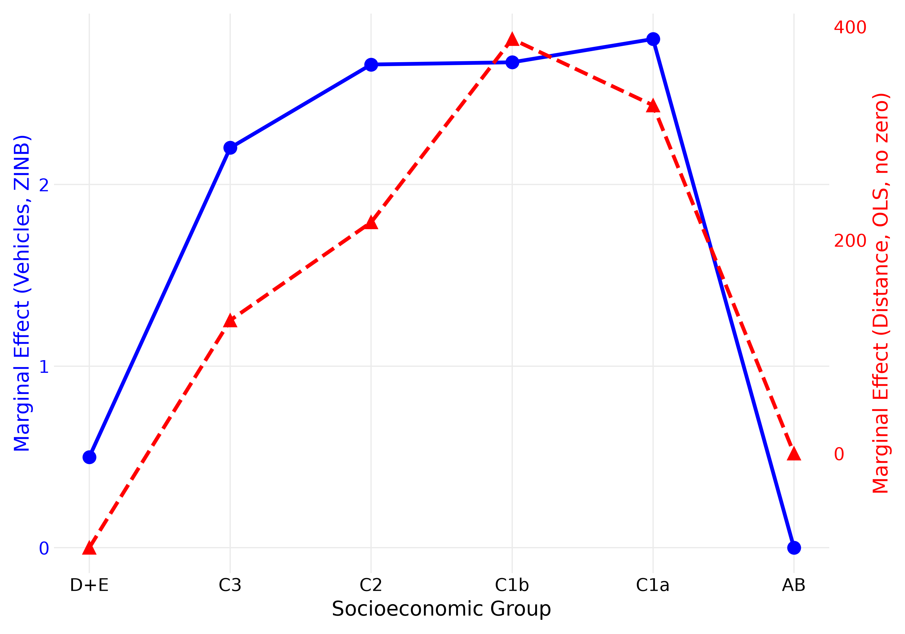
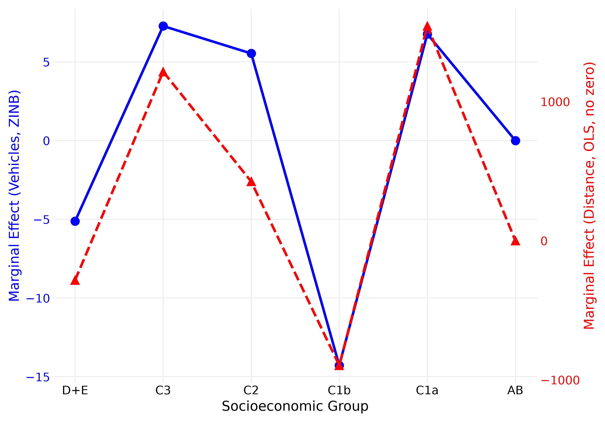

# Exposure to last-mile delivery emissions: réplica en Python

Réplica en Python de:

> Basso, F., Perotti, S., Pezoa, R., Fuentes, F., Covarrubia, J. (2026). *Exposure to last-mile delivery emissions: A novel data fusion approach*. Transportation Research Part D, 155, 105296. https://doi.org/10.1016/j.trd.2026.105296

El paper cruza, en una grilla **hexágono H3 (res. 9) × hora**, la actividad de vehículos de reparto (GPS) con la composición demográfica de la población presente (telefonía móvil) para medir qué grupos quedan más expuestos a la última milla en Santiago. Estima un **ZINB** para el conteo de vehículos y **OLS** para la distancia recorrida, con errores estándar agrupados por comuna, y compara contra un enfoque estático (demografía residencial).

> **Datos confidenciales.** Los datos del paper son confidenciales y no están en este repositorio. Sin ellos funcionan las pruebas sintéticas; los scripts de reproducción los necesitan (ver [Datos](#datos)).

## Resultados

La réplica reproduce los resultados del paper con los mismos valores y confirma sus conclusiones cualitativas principales: la **U invertida por nivel socioeconómico**, el **pico de exposición en 25–34 años** y el **cambio de C1b entre el enfoque dinámico y el estático**. Estas conclusiones se mantienen al corregir la zona horaria de los camiones. No se confirman la cifra del 24 % de mayor exposición de hombres ni la significancia estadística de varios efectos que el paper imprime. Detalle y cautelas en [`docs/conclusiones.md`](docs/conclusiones.md).

| Modelo dinámico (Fig. 6) | Modelo estático (Fig. 9) |
|---|---|
|  |  |

*Efecto marginal por grupo socioeconómico: ZINB (azul, eje izquierdo, vehículos) y OLS con distancia positiva (rojo, eje derecho, metros). Como en el paper, el eje derecho está reescalado: las figuras comparan formas, no magnitudes entre series.*

**Documentación**

- [`AGENTS.md`](AGENTS.md): metodología verificada, hallazgos, decisiones y estado del trabajo (referencia principal).
- [`docs/guia_paper_y_replica.md`](docs/guia_paper_y_replica.md): guía para entender y explicar el paper y la réplica (modelos, tablas, figuras, estrellas y diferencias con lo impreso).
- [`docs/conclusiones.md`](docs/conclusiones.md): ¿llegamos a las conclusiones del paper?
- [`docs/paper_map.md`](docs/paper_map.md): dónde está cada ecuación, tabla y figura del paper en el código.
- [`docs/figures/`](docs/figures/): figuras publicadas de la réplica.

## Contenido del repositorio

```
.
├── AGENTS.md              # Guía de trabajo: metodología verificada, hallazgos y decisiones
├── README.md
├── LICENSE                # MIT
├── pyproject.toml         # Paquete y configuración de pytest y ruff
├── requirements.txt       # Dependencias con versiones fijadas (Python 3.12)
├── src/lastmile_exposure/ # Código de la réplica, un módulo por concepto del paper
├── scripts/               # Un script por paso de la réplica
├── tests/                 # Pruebas sintéticas y validación contra el paper
├── reference/             # Cifras publicadas del paper y contrastes propios
├── docs/                  # Documentación de la réplica
│   ├── guia_paper_y_replica.md  # Guía: modelos, tablas, figuras y diferencias con el paper
│   ├── conclusiones.md          # ¿Llegamos a las conclusiones del paper?
│   ├── paper_map.md             # Índice paper → código
│   ├── reproduction_report.md   # Informe de reproducción publicado
│   └── figures/                 # Figuras publicadas
├── entregables/           # Documentos LaTeX y presentaciones (ver su README)
├── notebooks/             # Solo exploración
├── outputs/               # Resultados generados (no se versiona)
└── data/                  # Datos confidenciales (no se versiona)
```

## Requisitos

- **Python 3.12**
- **[uv](https://docs.astral.sh/uv/)** para crear y gestionar el entorno virtual (una sola vez por máquina):

  ```bash
  winget install --id=astral-sh.uv -e                 # Windows
  curl -LsSf https://astral.sh/uv/install.sh | sh     # macOS / Linux
  ```

- **Librerías** (versiones exactas en [`requirements.txt`](requirements.txt)):

  | Grupo | Paquetes | Uso |
  |---|---|---|
  | Núcleo | `numpy`, `pandas`, `pyarrow`, `scipy`, `tzdata` | datos, parquet, zona horaria `America/Santiago` |
  | Modelos | `statsmodels` | ZINB, logit, OLS, errores estándar con cluster por comuna |
  | Espacial | `h3` (v4), `shapely`, `pyproj`, `geopandas`, `libpysal`, `esda` | grilla H3, proyección a metros, Moran's I |
  | Transporte óptimo | `pot` | distancia de Wasserstein (movilidad, Tabla 2) |
  | Gráficos | `matplotlib` | figuras |
  | Desarrollo | `pytest`, `ruff`, `ipykernel` | pruebas, lint y formato, notebooks |

## Entorno virtual

Desde la raíz del repositorio:

```bash
uv venv --python 3.12 .venv
uv pip install --python .venv -r requirements.txt
uv pip install --python .venv -e . --no-deps      # instala el paquete lastmile_exposure
```

Activarlo:

| Shell | Comando |
|---|---|
| PowerShell | `.venv\Scripts\Activate.ps1` |
| Git Bash | `source .venv/Scripts/activate` |
| macOS / Linux | `source .venv/bin/activate` |

Si PowerShell bloquea la activación, habilita los scripts solo para esa sesión con `Set-ExecutionPolicy -Scope Process RemoteSigned`.

> En Windows la primera importación tras crear el entorno tarda varios minutos (escaneo del antivirus sobre ~800 MB). Es normal; las siguientes son rápidas.

## Datos

Los datos del paper son **confidenciales** (*"The data that has been used is confidential"*) y **no se versionan**: `data/` está en `.gitignore`. No los subas a servicios externos ni los incluyas en commits.

Los scripts de reproducción leen el paquete de replicación de los autores desde `data/replication_package_v2/`. Qué contiene cada archivo está descrito en [`AGENTS.md`](AGENTS.md) (§8.1).

## Reproducir resultados

Con el entorno activo y los datos disponibles en `data/`, un solo comando regenera todo y deja un **informe de reproducción** (qué coincide con el paper, qué no y qué cambió):

```bash
python scripts/16_run_all.py                # modo estándar (~9 min)
python scripts/16_run_all.py --mode quick   # ~4 min: sin los pasos más lentos
python scripts/16_run_all.py --publish      # además publica las figuras y el informe
```

El informe queda en `outputs/reproduction/report.md` (y `report.csv`). Con `--publish`, el informe también se copia a `docs/reproduction_report.md` y las figuras autorizadas a `docs/figures/`. Un paso que falla no detiene a los demás; el código de salida es 0 si el informe no tiene fallas. También acepta `--dry-run` (muestra el plan), `--report-only`, `--only 03,14` y `--skip 06`.

O ejecuta los scripts por separado:

| Script | Qué reproduce | Duración |
|---|---|---|
| `scripts/01_table2.py` | Tabla 2 (población flotante) | ~10 s |
| `scripts/02_distance_tables.py` | Columnas de distancia (OLS) de las Tablas 4 y 5 | ~10 s |
| `scripts/03_zinb_tables.py` | Columna ZINB de las Tablas 4 y 5 | ~1 min |
| `scripts/04_median_counts.py` | Mediana de conteos desde los 42 archivos diarios | ~30 s |
| `scripts/05_mobility.py` | Wasserstein y ranking de movilidad (Tabla 2), según el texto del paper | ~10 min; `--use-reference` es instantáneo |
| `scripts/06_inference.py` | Errores estándar por comuna y estrellas de las Tablas 4 y 5 | ~1 min |
| `scripts/07_stars_diagnosis.py` | **Diagnóstico, no es una réplica** (usa la base de 2 miércoles; no usar sus resultados) | — |
| `scripts/08_dispersion_test.py` | Test de Cameron–Trivedi (7,73) | ~10 s |
| `scripts/09_moran.py` | I de Moran (0,4694 y 0,4756) | segundos |
| `scripts/10_zero_inflation.py` | π del ZINB (diagnóstico; el paper no lo reporta) | ~4 min |
| `scripts/11_median_distance.py` | Mediana de distancia y tiempo desde los 41 archivos diarios | ~30 s |
| `scripts/12_mobility_seeds.py` | Wasserstein con el método de los autores y 200 semillas | ~40 min con 8 procesos; `--use-reference` es instantáneo |
| `scripts/13_local_time_sensitivity.py` | Sensibilidad en hora local (`America/Santiago`) de las Tablas 4 y 5 | ~2 min |
| `scripts/14_figures.py` | Figs. 6, 7, 8, 9 y 10 | segundos |
| `scripts/15_maps.py` | Fig. 1 y sustituto de la Fig. 2 | ~30 s |
| `scripts/16_run_all.py` | Ejecuta los pasos anteriores en orden y arma el informe de reproducción | ~4 min (`--mode quick`) a ~9 min (estándar) |
| `scripts/17_paper_format_tables.py` | Tablas 4 y 5 en el formato del paper, réplica y cifras impresas lado a lado (necesita antes el 03 y el 06) | segundos |

Los scripts son independientes entre sí, salvo dos: **ejecuta `03_zinb_tables.py` antes que `14_figures.py`**, porque las figuras leen las tablas que deja el 03, y **el 03 y el 06 antes que `17_paper_format_tables.py`**, que solo presenta lo que ellos calcularon (si faltan, el 14 y el 17 se detienen y lo avisan). `16_run_all.py` respeta el orden del 03 y el 14; el 17 es opcional y no forma parte del ejecutor, se corre aparte.

Cada script se ejecuta con `python scripts/NN_nombre.py` y escribe en `outputs/` (los resultados de la réplica en `outputs/as_published/`). Los que validan contra cifras publicadas (`reference/paper_tables/`) terminan con código 1 si algo difiere de su redondeo; los de diagnóstico y sensibilidad terminan siempre con 0. Los scripts 14 y 15 aceptan `--publish` para copiar las figuras autorizadas a `docs/figures/`. El detalle de cada script está en [`scripts/README.md`](scripts/README.md).

## Pruebas

```bash
pytest                 # todas; las que usan los datos se saltan solas si no están
pytest -m "not slow"   # omite los ajustes del ZINB completo sobre datos reales (minutos)
```

Estilo del código: `ruff check .` y `ruff format .`.

## Licencia

[MIT](LICENSE) © 2026 Nicolas Andres Fuentes Espinoza. El paper es propiedad de sus autores y de Elsevier; los datos son confidenciales y no están cubiertos por esta licencia.
